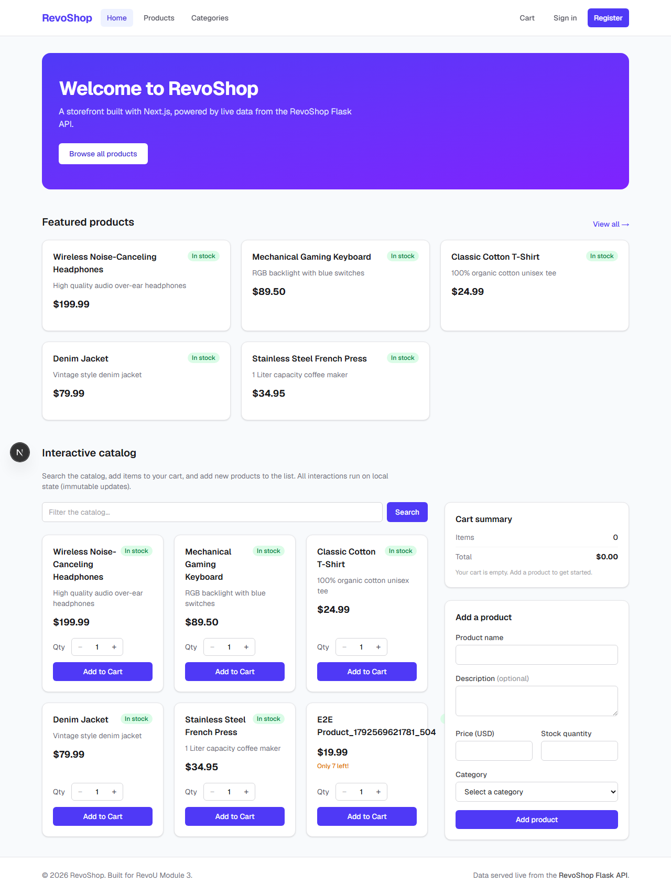
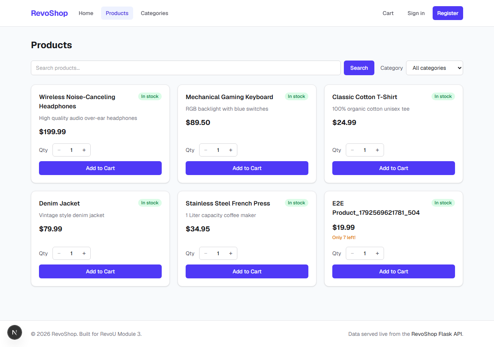
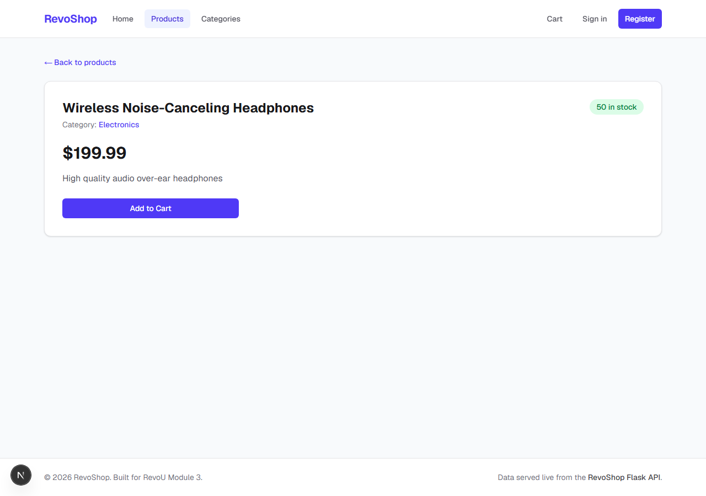
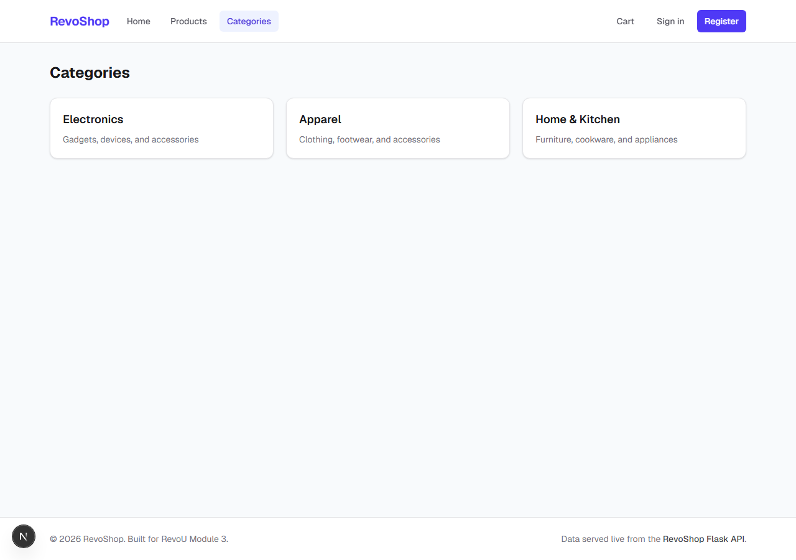
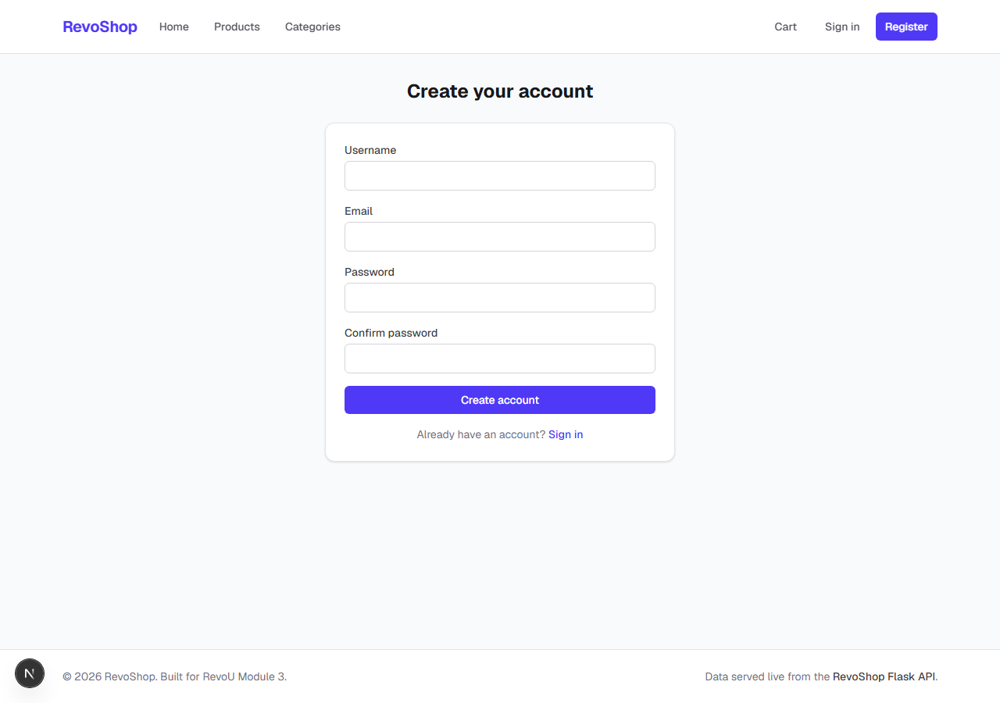
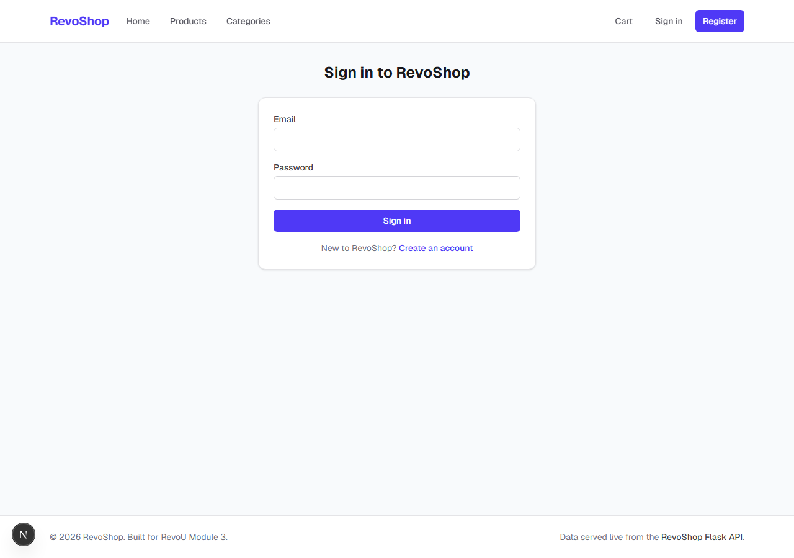
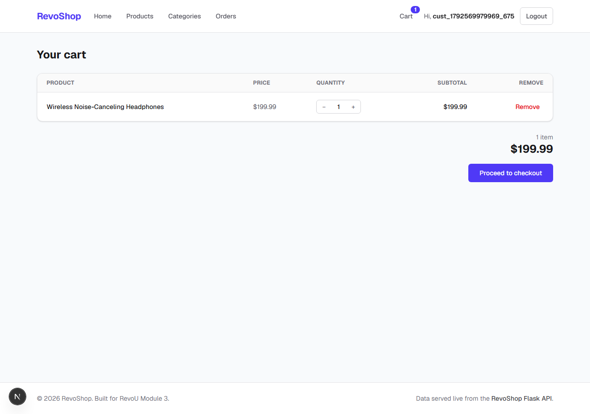
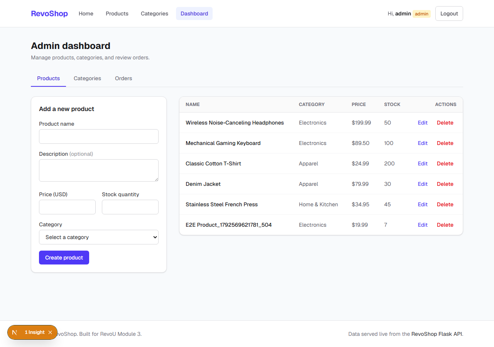
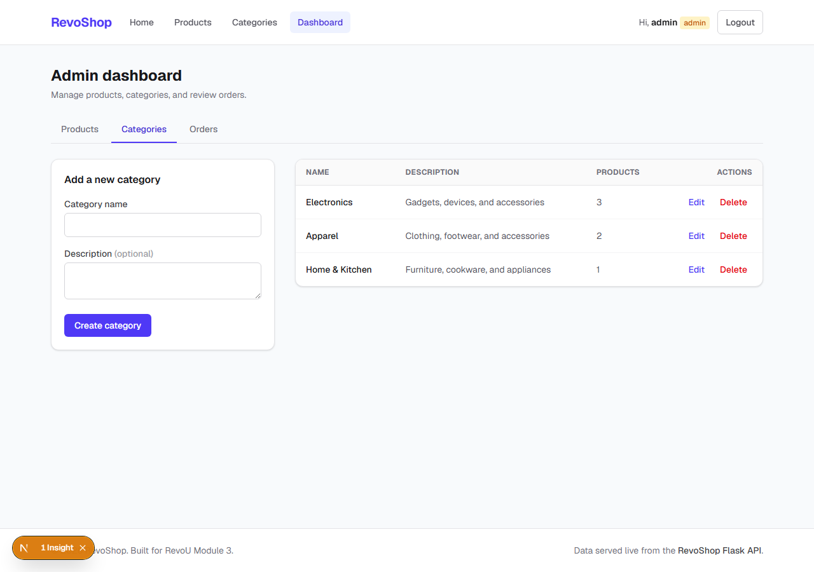

# RevoShop Frontend (Module 3)

A full-stack storefront built with **Next.js 16 (App Router)** and **Tailwind CSS v4**,
wired to the live **RevoShop Flask API** from Module 2. It covers the complete
real-world flow: browsing a live catalog, registering and logging in, managing a
persistent cart, checking out into real orders, and a role-gated admin dashboard with
full product and category CRUD.

**Live API:** https://module-2-limadijaya.onrender.com

## Overview

RevoShop is an e-commerce front end for the RevoShop API. Products, categories, and
orders are served from the real backend. The app has three audiences:

- **Guests** can browse products and categories and build a cart, but must sign in to
  check out.
- **Customers** register, log in, add items to a cart that persists across refreshes,
  check out to create an order, and review their own order history.
- **Admins** manage the catalog: full product and category CRUD plus a read-only
  overview of every order.

Sessions use the user object returned by the API, persisted in `localStorage` (the API
issues no token), so a refresh keeps you logged in. Role-based routing redirects admins
to `/dashboard` and customers to `/`, and the entire `/dashboard` subtree is guarded
against guests and customers.

## Features implemented

### Public / customer
- **Home** (`/`) — featured products (server-rendered) + interactive catalog.
- **Products** (`/products`) — live search (search-by-URL) and category filtering.
- **Product detail** (`/products/[id]`) — dynamic `generateMetadata` title + Add to Cart.
- **Categories** (`/categories`) — live category listing.
- **Register** (`/register`) — validates all fields, logs the user in, redirects by role.
- **Login** (`/login`) — validates fields, shows an error on invalid credentials, redirects by role.
- **Cart** (`/cart`) — item table with quantity steppers, per-row remove, running total,
  an empty state, and a checkout button that is disabled when the cart is empty. Cart is
  persisted in `localStorage`.
- **Checkout** (`/checkout`) — confirms an order via `POST /orders`, clears the cart, and
  redirects to `/orders`.
- **Orders** (`/orders`, `/orders/[id]`) — a customer's own orders and per-order detail
  (another user's order id is rejected).

### Admin (role: `admin`)
- **Dashboard** (`/dashboard`) — full product CRUD via `CreateProductForm` /
  `EditProductForm`, with a **delete guard**: a product referenced by an active order
  (pending/confirmed/shipped) cannot be deleted and shows a visible error.
- **Categories** (`/dashboard/categories`) — full category CRUD with a **delete guard**:
  a category with linked products cannot be deleted.
- **Orders** (`/dashboard/orders`) — read-only overview of every order across all users,
  with total-orders and total-revenue summaries.

### Cross-cutting
- **Auth + Cart React Contexts** with `localStorage` persistence.
- **Client-side route protection** (`useRequireAuth`) — guests → `/login`,
  customers → `/` for admin routes.
- **Toast notifications** (react-hot-toast) on success/error for every CRUD and cart action.
- **Role-aware header** — shows the username, a logout button, a cart badge with the live
  item count, and admin-only navigation.

## Technologies used

- **Next.js 16** (App Router, Cache Components, route handlers) + **React 19**
- **TypeScript** (strict)
- **Tailwind CSS v4**
- **react-hot-toast** — success/error notifications
- **next/navigation** — `useRouter`, `usePathname`, `useSearchParams`, `useParams`
- **localStorage** — session + cart persistence
- **Playwright** — end-to-end tests
- **`NEXT_PUBLIC_API_BASE_URL`** — configures the Flask API base URL

## Project structure

```
app/
  layout.tsx                 Root layout — Providers (Auth + Cart + Toaster) + Header/Footer
  page.tsx                   Home (featured + interactive catalog)
  register/ login/           Auth pages (role-based redirects)
  products/                  List, detail, loading, error, not-found
  categories/                Category listing
  cart/                      Cart table, remove, disabled-when-empty checkout
  checkout/                  Confirm order → POST /orders → clear cart → /orders
  orders/                    Customer's own orders + [id] detail
  dashboard/                 Admin shell (admin-guarded) + products / categories / orders
  api/                       Same-origin proxy route handlers → Flask API
    auth/{register,login}/   POST proxies
    products/ products/[id]/ GET/POST, PUT/DELETE
    categories/ …/[id]/      GET/POST, PUT/DELETE
    orders/ orders/[id]/     GET/POST, GET
components/                  Header, forms (Register/Login/Product/Category), AddToCartButton, …
context/                     AuthContext, CartContext, Providers
lib/                         api.ts, client-api.ts, types.ts, format.ts, storage.ts,
                             route-helpers.ts, useRequireAuth.ts
e2e/                         Playwright specs (auth, shopping, admin) + helpers
```

### How auth + data flow works

- **Server Components** fetch via `lib/api.ts` (typed `fetch` with retry/backoff and a
  typed `ApiError`).
- **Client Components** fetch via `lib/client-api.ts`, which calls the app's own
  same-origin `/api/*` route handlers. Those handlers proxy to the external Flask API
  **server-side**, avoiding CORS and browser TLS issues.
- **Auth**: `POST /auth/login` / `POST /users` return a user object (no token). The
  `AuthContext` persists it to `localStorage`; `useRequireAuth` guards protected routes
  on the client.
- **Deletion guards** are enforced in the frontend because the backend returns a raw
  error when referential constraints are violated.

## Getting started

```bash
npm install
npm run dev
```

Open http://localhost:3000.

Environment variables live in `.env.local` (see `.env.example`):

```bash
NEXT_PUBLIC_API_BASE_URL=https://module-2-limadijaya.onrender.com
API_SECRET_KEY=dev-secret-key-12345
```

- `NEXT_PUBLIC_API_BASE_URL` is exposed to the browser and used by client-side fetches.
- `API_SECRET_KEY` is server-only (not prefixed with `NEXT_PUBLIC_`).

> **Note:** the API runs on Render's free tier and sleeps after inactivity, so the first
> request after an idle period can take 30–60s. The data layer retries with backoff to
> ride out cold starts.

> **TLS behind a corporate proxy:** if server-side fetches fail with
> `UNABLE_TO_VERIFY_LEAF_SIGNATURE`, run Node with the system cert store:
> ```bash
> # macOS/Linux
> NODE_OPTIONS=--use-system-ca npm run dev
> # Windows PowerShell
> $env:NODE_OPTIONS="--use-system-ca"; npm run dev
> ```

## Scripts

| Script                 | Description                          |
| ---------------------- | ------------------------------------ |
| `npm run dev`          | Start the dev server                 |
| `npm run build`        | Production build                     |
| `npm run start`        | Serve the production build           |
| `npm run lint`         | Run ESLint                           |
| `npm run test:e2e`     | Run the Playwright E2E suite         |
| `npm run test:e2e:ui`  | Run Playwright in interactive UI mode |

## Running the test suite

The E2E suite uses **Playwright** and runs against a locally served app that talks to the
live Module 2 API.

1. Install dependencies and the Playwright browser (one time):
   ```bash
   npm install
   npx playwright install chromium
   ```
2. Run the suite (Playwright starts the dev server automatically):
   ```bash
   npm run test:e2e
   ```
   On Windows behind a TLS proxy:
   ```powershell
   $env:NODE_OPTIONS="--use-system-ca"; npm run test:e2e
   ```
3. Open the HTML report after a run:
   ```bash
   npx playwright show-report
   ```

### Running against the live deployment

Set `PLAYWRIGHT_BASE_URL` to a deployed URL (e.g. the Vercel production URL) to run
the same suite against it. When the base URL is not `localhost`, Playwright skips the
local dev server and hits the live site directly:

```bash
# macOS/Linux
PLAYWRIGHT_BASE_URL=https://module-3-limadijaya-frontend.vercel.app npm run test:e2e
```
```powershell
# Windows PowerShell
$env:PLAYWRIGHT_BASE_URL="https://module-3-limadijaya-frontend.vercel.app"; npm run test:e2e
```

### What the tests cover

- **`e2e/auth.spec.ts`** — registration, session persistence across refresh, field
  validation, logout → login, invalid-credential error, and a logged-out redirect away
  from `/dashboard`.
- **`e2e/shopping.spec.ts`** — the full browsing journey: products list → add to cart →
  cart table → checkout → order placed and cart cleared, plus the empty-cart disabled
  checkout and remove-item empty state.
- **`e2e/admin.spec.ts`** — the full admin CRUD dashboard journey (create → edit → delete
  a product), category create/delete with name validation, the read-only orders overview,
  and a customer being redirected away from the dashboard.

> **Admin sessions in tests:** the public API only ever creates `customer` users, so the
> admin specs seed an admin session into `localStorage` (the app's session model) and
> then drive the real CRUD endpoints. See `e2e/helpers.ts`.

## Screenshots

### Home


### Products listing


### Product detail


### Category listing


### Register


### Login


### Cart


### Admin dashboard — product CRUD


### Admin dashboard — category CRUD

