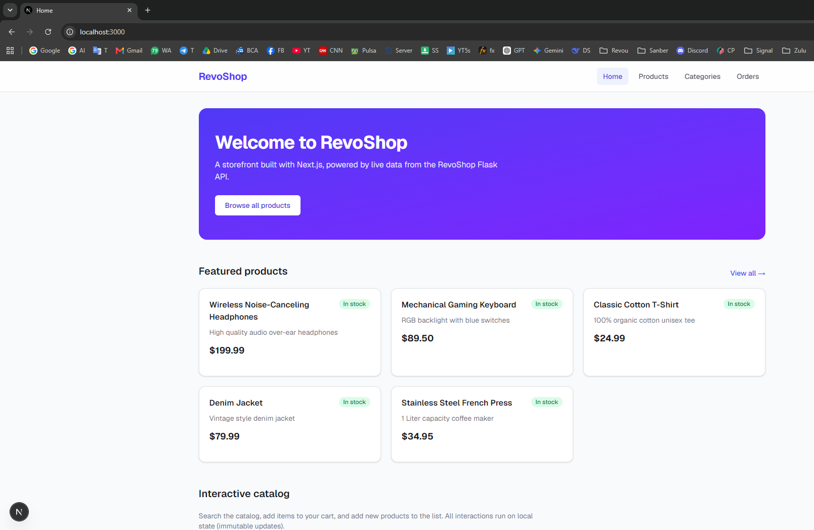
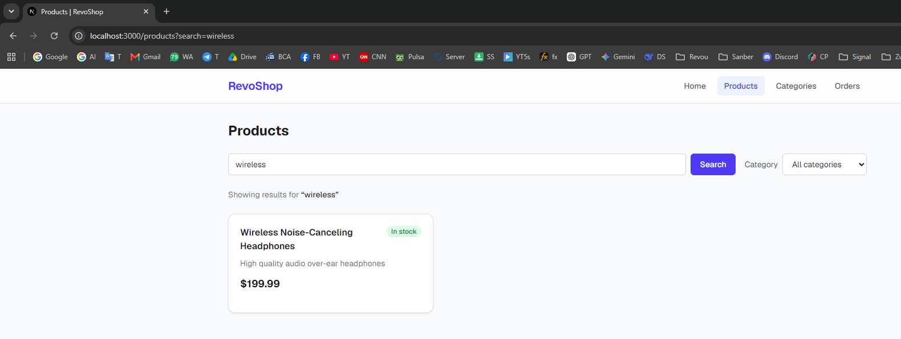
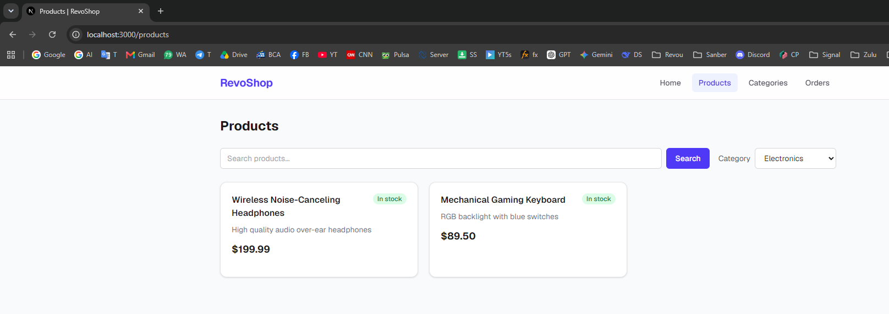
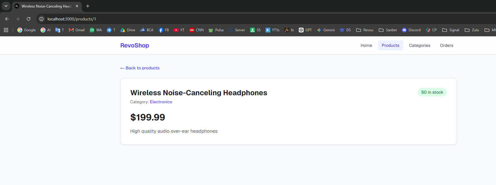
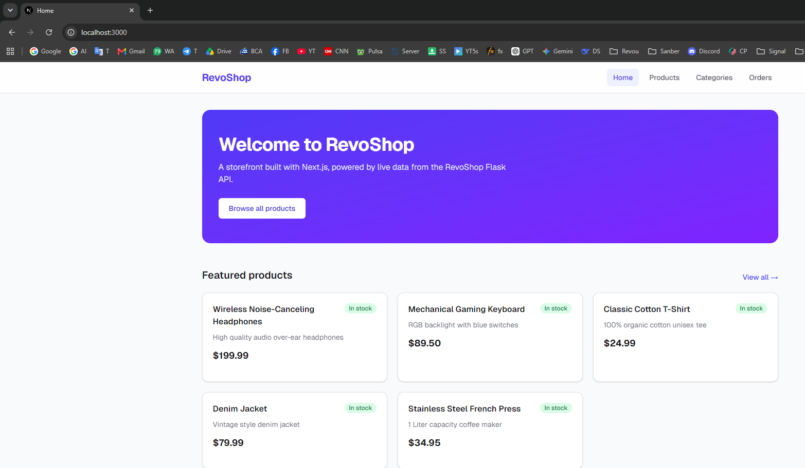
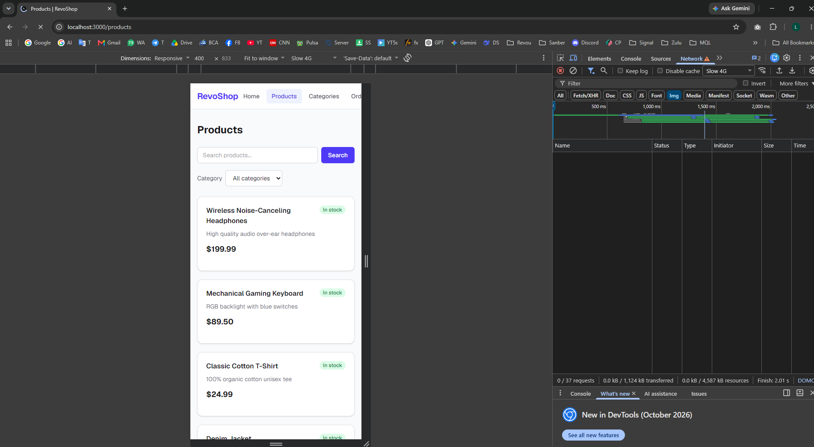

# RevoShop Frontend (Module 3)

A storefront built with **Next.js 16 (App Router)** and **Tailwind CSS v4**, wired to
the live **RevoShop Flask API** from Module 2. Products, categories, and orders are
all fetched server-side from the real backend.

**Live API:** https://module-2-limadijaya.onrender.com

## Getting started

```bash
npm install
npm run dev
```

Open http://localhost:3000.

Environment variables live in `.env.local` (see `.env.example`):

```bash
NEXT_PUBLIC_API_BASE_URL=https://module-2-limadijaya.onrender.com
API_SECRET_KEY=dev-secret-key-12345
```

- `NEXT_PUBLIC_API_BASE_URL` is exposed to the browser (used by client-side refetches).
- `API_SECRET_KEY` is server-only (reserved for authenticated calls in Checkpoint 3).

> **Note:** the API runs on Render's free tier and sleeps after inactivity, so the
> first request after an idle period can take 30–60s. The data layer retries with
> backoff to ride out cold starts.

> **TLS behind a corporate proxy:** if server-side fetches fail with
> `UNABLE_TO_VERIFY_LEAF_SIGNATURE`, your network is intercepting TLS with a custom
> root CA that Node doesn't trust by default. Run Node with the system cert store:
> ```bash
> # macOS/Linux
> NODE_OPTIONS=--use-system-ca npm run dev
> # Windows PowerShell
> $env:NODE_OPTIONS="--use-system-ca"; npm run dev
> ```

## Scripts

| Script          | Description                          |
| --------------- | ------------------------------------ |
| `npm run dev`   | Start the dev server                 |
| `npm run build` | Production build                     |
| `npm run start` | Serve the production build           |
| `npm run lint`  | Run ESLint                           |

## Project structure

```
app/
  layout.tsx              Root layout — wraps every page with <Header/> + <Footer/>
  page.tsx                Home — Server Component, first 5 products + interactive catalog
  products/
    layout.tsx            Nested layout (stays mounted across list <-> detail)
    page.tsx              Products list (server fetch) + <ProductList/> client browser
    loading.tsx           Skeleton while fetching
    error.tsx             Error boundary (covers the whole /products subtree)
    [id]/
      page.tsx            Product detail + generateMetadata (dynamic <title>)
      loading.tsx         Detail skeleton
      not-found.tsx       Shown on a 404 from the API
  categories/             page.tsx + loading.tsx + error.tsx (GET /categories)
  orders/                 page.tsx + loading.tsx + error.tsx (GET /orders)
components/
  Header, Footer, Card, ProductCard, ProductGrid, SearchBar, AddProductForm,
  CategoryFilter, ProductList, CartSummary, ProductCatalog
lib/
  api.ts                  Typed fetch helpers + ApiError + retry/backoff
  types.ts                Product / Category / Order interfaces
  format.ts               formatPrice(), getButtonClasses()
```

## How data fetching works

This project uses Next.js 16's **Cache Components** model. Pages render a static
shell immediately and stream live API data behind `<Suspense>` boundaries:

- **Server Components** fetch with native `async/await` + `fetch` (`lib/api.ts`).
- Each fetch does a `res.ok` check and throws a typed `ApiError` on failure.
- Every data-fetching route has a `loading.tsx` skeleton and an `error.tsx` boundary.
- `/products/[id]` uses `generateMetadata` to fetch the product and set a dynamic
  page title. The product fetch is wrapped in `React.cache` so metadata and the page
  share a single request.

## Interactive catalog (client state)

The home page includes a client-side catalog exercise (`ProductCatalog`):

- live search filtering,
- "Add to Cart" with immutable state updates,
- a cart summary (item count + total),
- `AddProductForm` with controlled inputs and a `validate()` function that appends
  new products to the list via the immutable spread pattern.

The `/products` page's `ProductList` demonstrates **search-by-URL**: the search bar
calls `router.push('/products?search=…')`, and a `useEffect` reads `useSearchParams()`
and refetches on every query (or category) change.

> The Module 2 API currently ignores `?search=` and `?category_id=` params, so the
> data layer sends those params (forward-compatible) and also filters the returned
> results client-side so search and category filtering work end-to-end today.

## Demo Evidence

Captured running locally against the live Module 2 API.

### Home — 5 real products from the API
The home page fetches `GET /products` in a Server Component and renders the first
five results as read-only product cards.



### Live search on /products
Typing a query and pressing Enter navigates to `/products?search=…`; the list
updates to matching products.



### Category filtering on /products
Selecting a category from the dropdown filters the product grid to that category.



### Product detail with a dynamic page title
`/products/[id]` fetches the product server-side and uses `generateMetadata` to set
the browser tab title to the real product name (e.g. `… | RevoShop`).



### Active-route highlighting in the nav
The navigation bar highlights the current route using `usePathname()`.



### loading.tsx skeleton state
While a data-fetching route streams its data, the `loading.tsx` skeleton UI is shown
(captured with network throttling enabled).


